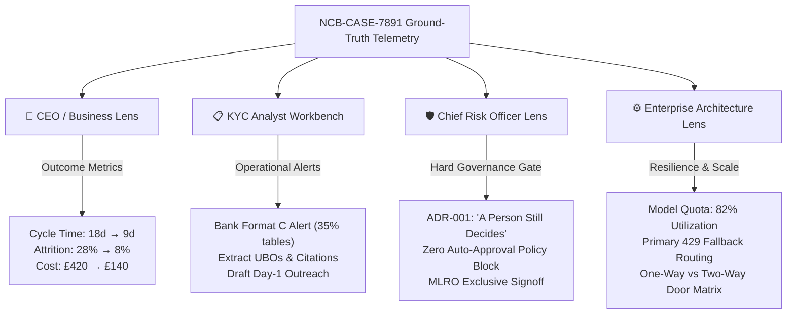

# Northgate Corporate Bank — Enterprise Agent Architecture Prototype
### Virtusa Lead FDE Programme — Module 8: Delivery Leadership & War Room

[](https://github.com/BritiJadav/northgate)
[]()
[]()
[]()

A reference implementation demonstrating the **5 Core Pillars of an Enterprise-Grade Agentic System** and **Multi-Stakeholder Delivery Leadership** built for Northgate Corporate Bank under the **Virtusa Lead FDE Programme (Module 8: Delivery Leadership · War Room)**.

---

## 📑 Complete Presentation Guide
> **Looking for the presentation script?**  
> See the complete presentation script and guide: **[`Northgate_Complete_Presentation_Script.pdf`](./Northgate_Complete_Presentation_Script.pdf)**.

---

## 🏛 The 5 Architectural Pillars

| Pillar | Concept | Implementation in this Prototype |
| :--- | :--- | :--- |
| **A. Security** | API-based Header Auth & RBAC | • **Frontend never touches LLMs directly**.<br>• Every call requires `Authorization: Bearer <token>` and `X-API-Key: <key>`.<br>• Backend verifies Role-Based Access Control (RBAC: `analyst`, `ops_lead`, `mlro`, `admin`). |
| **B. Agent Toner** | Model Decoupling & Runtime Swapping | • Models live **outside** hardcoded agent logic.<br>• Dynamic Model Registry allows swapping models (`gemini-1.5-pro`, `claude-3-5-sonnet`, `gpt-4o`, `flash`) and tuning temperatures at runtime via API. |
| **C. Governance** | Per-Action Cost Tracing & Agent Ownership | • Every action logs an immutable trace: `trace_id`, `action_id`, exact input/output tokens, cost in USD, and execution latency.<br>• **Agent Owner Transparency**: Every agent is attributed to a business owner (`Sarah Jenkins`, `Elena Gomez`, `David Ross`).<br>• Administrators can inspect and **individually tune or fix that agent** at runtime. |
| **D. Resilience** | Multi-Provider Primary & Secondary Fallback | • Primary model: `Google Gemini 1.5 Pro` (via Enterprise AI Gateway).<br>• Secondary fallback: `Anthropic Claude 3.5 Sonnet` / `Azure OpenAI`.<br>• Automatic circuit break & failover on HTTP 429 quota exhaustion, timeout, or service outage.<br>• Built-in **Fault Injection Simulator** to demonstrate failover live. |
| **E. Critic Agent** | Anti-Hallucination & Document Citations | • Primary agents produce structured proposals citing exact source filings: `[Doc: ..., Section: ...]`.<br>• **Second-Line Critic Agent (Claire Bennett / Model Risk)** independently audits citations against raw text.<br>• Enforces Northgate **ADR-001**: AI generates unsealed drafts; **Person Signs 1, 2, 3** are required before commit. |

---

## 🎯 4 Stakeholder Lenses (From the Same Underlying Case Data)

This prototype demonstrates how **one source of truth (`NCB-CASE-7891 - Apex Global Logistics Ltd`)** powers four distinct executive and operational dashboards without data divergence:



1. **👔 CEO / Business Dashboard**: Focuses on commercial outcomes — reducing end-to-end cycle time from 18 days to 9 days, dropping onboarding attrition from 28% to 8%, and cutting processing cost per case from £420 to £140.
2. **📋 KYC Analyst Operational Workbench**: Operational alert highlights *"Format C detected (35% table format)"* and equips the human investigator to extract complex 4-tier PSC ownership trees and draft complete Day-1 gap emails.
3. **🛡️ Chief Risk Officer (CRO) & Compliance**: Enforces **ADR-001 ("A Person Still Decides")**. Demonstrates strict policy blocking against automated risk scoring; only a licensed MLRO can sign off risk ratings.
4. **⚙️ Enterprise Architecture & Quotas**: Monitors LLM token throughput, 82% Tier-2 quota saturation, automated circuit-breaking, and the Type-1 vs Type-2 Architectural Door matrix.

---

## ⚡ Pillar 5: Virtusa Module 8 Delivery Leadership War Room

The War Room dashboard provides senior engineering leadership tools to handle real-world operational crises:
* **Interactive 8-Inject Decision Log**: Covers all 8 canonical Virtusa Module 8 delivery injects (Round 1 & Round 2), tracking:
  - Injects #1-#8 (Customer Attrition, Format C Table Failures, MLRO Auto-Decision Ban, Quota Exhaustion, Model Drifts, etc.)
  - Architecture Door classification (One-Way vs Two-Way Door)
  - Named Owner & Action Taken
  - Multi-stakeholder communications
* **"Same News, Three Audiences" Translator**: Interactive executive briefing module showing how a single critical engineering event (e.g. Model Quota Saturation) is communicated transparently to:
  1. *Executive Sponsor / Business* (Client impact & capacity protection)
  2. *Risk & Compliance* (Audit compliance & verification that safety gates hold)
  3. *Engineering Team* (Failover thresholds, circuit breaker parameters, load balancing)

---

## 📂 Project Directory Structure

```
Northgate/
├── backend/
│   ├── app.py                # FastAPI REST Server & Multi-Stakeholder Endpoints
│   ├── auth.py               # Header-based API Authentication & RBAC Dependencies
│   ├── config.py             # Security keys, model pricing matrix ($/1M tokens)
│   ├── governance.py         # Trace logging, cost calculation, agent ownership & War Room registry
│   ├── model_gateway.py      # Multi-provider gateway with auto-failover & fault injection
│   ├── data/
│   │   └── sample_cases.py   # Corporate cases (UK Companies House, Dutch KVK, ACRA)
│   └── agents/
│       ├── base.py           # Base agent with automated governance & tracing
│       ├── ubo_extractor.py  # Primary Agent 1: Ownership tree & UBOs with citations
│       ├── gap_detector.py   # Primary Agent 2: "See every gap at the start" outreach drafter
│       └── critic_agent.py   # Second-Line Critic: Citation verifier & hallucination checker
├── frontend/
│   └── index.html            # Complete, interactive enterprise executive dashboard (Light Theme)
├── Northgate_Complete_Presentation_Script.pdf # Complete presentation script for project guide
├── run_server.py             # Single-command launcher
├── test_prototype.py         # End-to-end integration test suite
├── requirements.txt          # Python dependencies
└── README.md
```

---

## 🚀 Running the Project Locally

### 1. Prerequisites
* Python 3.10+
* Windows / Linux / macOS

### 2. Install Dependencies
```bash
pip install -r requirements.txt
```

### 3. Launch the Application Server
```bash
python run_server.py
```
* **Interactive Dashboard**: Open [`http://127.0.0.1:8080/static/index.html`](http://127.0.0.1:8080/static/index.html) in your browser.
* **Interactive Swagger API Docs**: Open [`http://127.0.0.1:8080/docs`](http://127.0.0.1:8080/docs).

---

## 👨‍🏫 Guide Presentation Checklist

When presenting this project to your evaluator or guide, follow this 4-step sequence:
1. **Show the 4 Stakeholder Lenses (Top Navigation Bar)**:
   - Click **👔 CEO / Business** to highlight the business case (18 → 9 days cycle time).
   - Click **📋 Analyst Workbench** to show the Format C operational alert and extract UBOs.
   - Click **🛡️ CRO & Risk** to prove adherence to **ADR-001** ("A Person Still Decides" policy block).
   - Click **⚙️ Architecture & Quotas** to demonstrate Model Gateway quotas and primary/secondary fallback.
2. **Demonstrate Fallback & Fault Injection**:
   - In Tab 2 (*Agent Toner & Fallback Resilience*), click *"Simulate Primary 429 Outage"*.
   - Return to Tab 1 and run the extractor. Point out the yellow `[⚠ FALLBACK]` badge showing seamless failover to Anthropic Claude 3.5 Sonnet.
3. **Demonstrate Second-Line Critic Agent**:
   - Run the Critic Agent and highlight the **100% Citation Grounding score** verifying each PSC against Companies House filings.
4. **Open the Virtusa Delivery War Room**:
   - Click **⚡ Virtusa War Room** to review the interactive 8-inject decision log and test the "Same News, Three Audiences" translator.

---
*Created by **BritiJadav** for the Virtusa Lead FDE Programme.*
